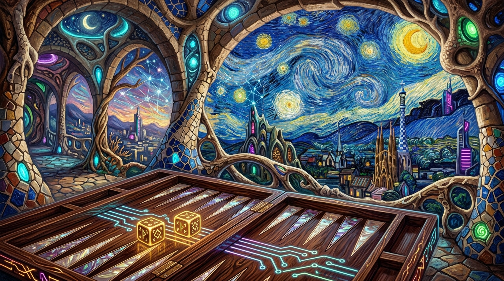
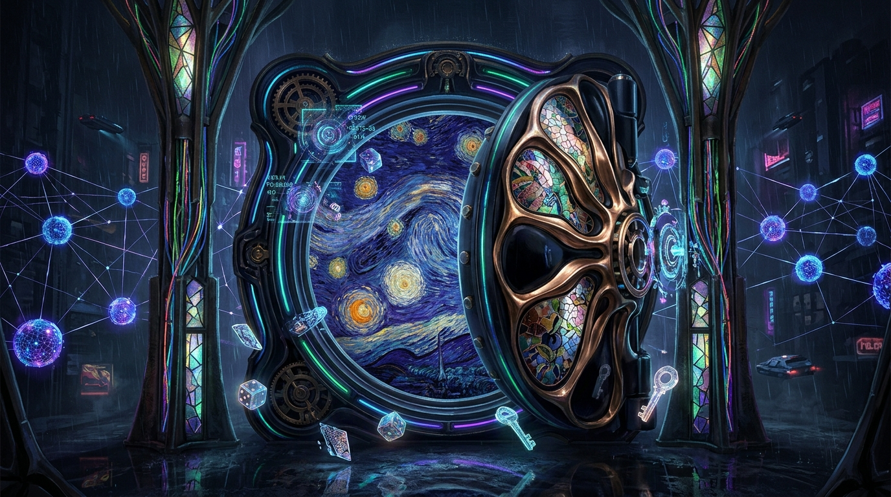

<p align="center">
  
</p>

# 🎲 Shesh-Besh (MadGammon)
### Sovereign Cryptographic Backgammon & Zero-Knowledge Privacy Ecosystem

<p align="center">
  <a href="README.md"><b>🇬🇧 English</b></a> •
  <a href="README.ru.md"><b>🇷🇺 Русский</b></a> •
  <a href="README.es.md"><b>🇪🇸 Español</b></a>
</p>

<p align="center">
  
  
  
  
  
</p>

---

## 🌌 Architectural Philosophy: Plausible Deniability

**MadGammon** is built from the ground up around the principle of **Plausible Deniability**:

```
+---------------------------------------------------------------------------------+
|                                 MADGAMMON FAÇADE                                |
|  • Backgammon Engine: MAD (Crazy), LONG, SHORT with tactical offline/online AI   |
|  • Cyberpunk AVS Music Visualizer (12 demoscene presets, SomaFM streaming)      |
|  • MatrixKeyboard: Built-in virtual keyboard bypassing Android system keyloggers |
+---------------------------------------------------------------------------------+
                                         │
                    [Secret Trigger / 6-Digit Master PIN]
                                         ▼
+---------------------------------------------------------------------------------+
|                        SOVEREIGN CRYPTOGRAPHIC VAULT                            |
|  • BIP-39 Sovereign Identity: Strictly 24 words + Ed25519 / X25519 Derivation   |
|  • Mental Dice: Provably fair HMAC-SHA256 Commit-Reveal (zero server trust)     |
|  • E2EE Private Chat: Double Ratchet with constant-size 16KB DPI-proof padding  |
|  • Anti-Censorship MultiPath: Tor Onion SOCKS5 + V2Ray + native Tun2Socks router|
|  • Panic Lockdown: Decoy PIN seals confidential vault for 48h (recovery via 24w)|
+---------------------------------------------------------------------------------+
```

---

## ✨ Key Capabilities

### 🎲 Sovereign Backgammon Engine
* **Three Game Rulesets**:
  * **MAD («Бешеные нарды»)**: Cascading doubles with unused dice transfer to opponent.
  * **LONG (Классические длинные)**: Traditional Eastern long backgammon rules (head rule, six-prime barrier check).
  * **SHORT (Короткие нарды)**: Classic international tournament backgammon with bar re-entry and bearing off.
* **Provably Fair Mental Dice**: Peer-to-peer dice generation via cryptographic HMAC-SHA256 commit-reveal protocol with zero central server involvement.

### 🎨 Cyberpunk AVS Visualizer Studio
* **Edge-to-Edge Fullscreen Screensaver**:
  * 12 hand-tuned Winamp/demoscene style audio visualizer presets (*Neon Gridwave, Cyber Mandala, Quantum Horizon, Plasma Firestorm, Liquid Nebula, Pulsar Ring, etc.*).
  * Real-time Android `Visualizer` API spectrum capture (with synthetic mathematical spectrum fallback).
  * Gesture controls, HUD OSD, and low-power battery optimization.
* **Integrated Cyberpunk Internet Radio**: Background SomaFM streams (Groove Salad, Secret Agent, DEF CON Radio) and custom Telegram audio channel streaming.

### 🔐 Cryptographic Identity & 24-Word BIP-39 Standard
* **Deterministic 24-Word Onboarding**:
  * Generated with 256-bit cryptographically secure entropy (`SecureRandom`) + 8-bit SHA-256 checksum.
  * Derives Ed25519 signing identity keys and X25519 Diffie-Hellman ratcheting keypairs.
  * Single-tap clipboard copy, 3-word verification gate, and offline printable vector **PDF Passport Certificate**.

### 💬 End-to-End Encrypted Private Mesh
* **Double Ratchet Protocol**: Signal-grade ratcheting with AES-256-GCM authenticated payload encryption.
* **Constant 16KB Padding**: Defeats Deep Packet Inspection (DPI) traffic analysis by equalizing all packet lengths.
* **SimpleX SMP / XFTP**: Anonymous decentralized messaging relays with no user IDs or phone numbers.

### 🧅 Anti-Censorship MultiPath Tunneling
* **Native Tun2Socks Router**: Bridges Android VPN `tun_fd` into local SOCKS5 proxy via high-performance native binaries (`libhev-socks5-tunnel.so`).
* **MultiPath Happy Eyeballs v2**: Connection racing across Direct, V2Ray/Xray, and Tor Onion circuits.
* **Android 14+ Foreground Service**: Bulletproof background message delivery with wake locks and heartbeat keep-alives.

---

## 🦀 Native Rust Core (`native/madgammon-core`)

Performance-critical and zero-trust modules are implemented in memory-safe **Rust** with automated zeroization (`ZeroizeOnDrop`) and compiled via **Mozilla UniFFI**:

| Module | Crate Path | Function |
| :--- | :--- | :--- |
| **`mental_dice`** | `crypto::mental_dice` | HMAC-SHA256 Commit-Reveal peer dice generation |
| **`double_ratchet`** | `crypto::double_ratchet` | Double Ratchet session ratcheting with 16KB fixed padding |
| **`hybrid_pq`** | `crypto::hybrid_pq` | X25519 KEM key exchange with 4-emoji SAS verification |
| **`erasure`** | `vault::erasure` | Reed-Solomon $GF(2^8)$ error correction & multi-shard vault |
| **`mnemonic`** | `vault::mnemonic` | BIP-39 24-word seed generation & PBKDF2-HMAC-SHA512 derivation |
| **`rules`** | `engine::rules` | Deterministic backgammon state machine (MAD/LONG/SHORT) |
| **`tun2socks`** | `net::tun2socks` | Asynchronous TUN interface to SOCKS5 packet router |

---

## 🛠️ Build & Installation

### Prerequisites
* **JDK:** OpenJDK 17 or Adoptium Temurin 21 LTS
* **Android SDK:** Compile & Target SDK 36, Android NDK r27c
* **Rust Toolchain:**
  ```bash
  rustup target add aarch64-linux-android x86_64-linux-android
  cargo install cargo-ndk uniffi-bindgen --version 0.28.0
  ```

### 1. Build Native Rust Core
```bash
chmod +x scripts/build_rust_core.sh
./scripts/build_rust_core.sh
```

### 2. Compile Android APK
```bash
./gradlew assembleDebug
# Generated APK: app/build/outputs/apk/debug/app-debug.apk
```

### 3. Run Unit Tests
```bash
# Run JVM crypto, data, AVS, and game engine tests
./gradlew testDebugUnitTest --tests "com.example.crypto.*" --tests "com.example.data.*" --tests "com.example.ui.avs.*" --tests "com.example.model.*"
```

---

## 🛡️ Security Best Practices

1. **Panic Decoy PIN**: If coerced to unlock the application, entering the panic PIN instantly launches innocuous backgammon games while sealing the sovereign crypto-vault for 48 hours. Unsealing requires the 24-word BIP-39 recovery seed.
2. **Keylogger Defense**: All PIN and seed entries can be typed through the internal `MatrixKeyboard` canvas, which avoids Android's input method service (IME) and clipboard eavesdropping.
3. **Air-Gapped Cold Storage**: Export the official **PDF Passport** immediately after onboarding and store it in an offline, physical safe.

---

## 📜 Official Rules & Documentation

* [**Official Backgammon Rules (MAD / LONG / SHORT)**](docs/RULES.md)

---

<p align="center">
  
</p>
