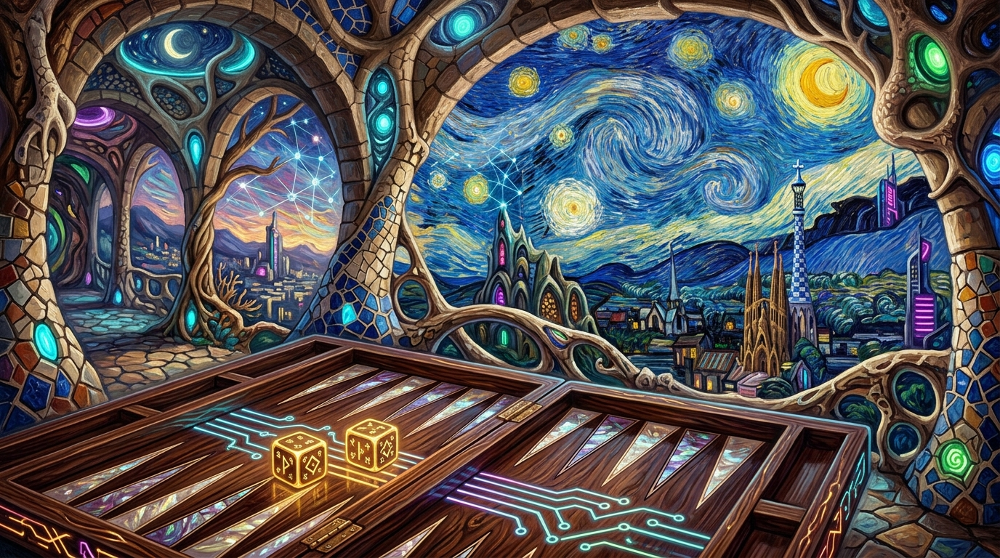
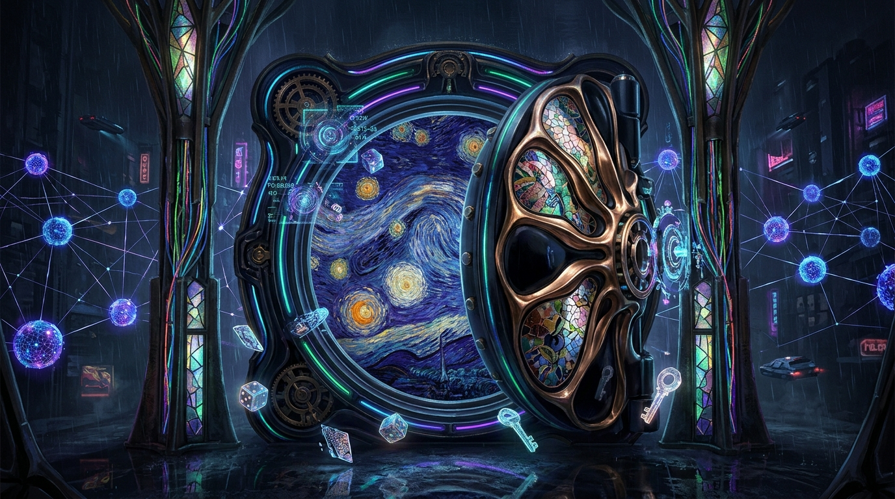

<p align="center">
  
</p>

# 🎲 Шеш-Беш (MadGammon)
### Суверенный криптографический комплекс нард и приватная Zero-Knowledge экосистема

<p align="center">
  <a href="README.md"><b>🇬🇧 English</b></a> •
  <a href="README.ru.md"><b>🇷🇺 Русский</b></a> •
  <a href="README.es.md"><b>🇪🇸 Español</b></a>
</p>

<p align="center">
  
  
  
  
  
</p>

---

## 🌌 Архитектурная концепция: Правдоподобное Отрицание (Plausible Deniability)

**Шеш-Беш (MadGammon)** спроектирован по фундаментальному принципу **правдоподобного отрицания**:

```
+---------------------------------------------------------------------------------+
|                                 ФАСАД ПРИЛОЖЕНИЯ                                |
|  • Игровой движок: БЕШЕНЫЕ (MAD), ДЛИННЫЕ (LONG), КОРОТКИЕ (SHORT) нарды        |
|  • Киберпанк AVS Музыкальная студия (12 demoscene пресетов, SomaFM стриминг)    |
|  • MatrixKeyboard: Встроенная виртуальная клавиатура в обход кейлоггеров ОС      |
+---------------------------------------------------------------------------------+
                                         │
                    [Секретный триггер / 6-значный Мастер-PIN]
                                         ▼
+---------------------------------------------------------------------------------+
|                         СУВЕРЕННЫЙ КРИПТОГРАФИЧЕСКИЙ КОНТУР                     |
|  • BIP-39 Сид-фраза: Строго 24 слова + деривация ключей Ed25519 / X25519        |
|  • Mental Dice: Доказуемо честные зарики HMAC-SHA256 Commit-Reveal (без сервера)|
|  • E2EE Приватный чат: Double Ratchet со статическим паддингом 16KB против DPI  |
|  • Антицензурный MultiPath: Tor Onion SOCKS5 + V2Ray + нативный Tun2Socks       |
|  • Тревожный PIN (Panic): Запечатывает секреты на 48ч (восстановление по 24 сл.)|
+---------------------------------------------------------------------------------+
```

---

## ✨ Ключевые возможности

### 🎲 Суверенный игровой движок нард
* **Три канонических разновидности нард**:
  * **MAD («Бешеные нарды»)**: Каскадные куши с передачей несыгранных очков зариков сопернику.
  * **LONG (Классические длинные нарды)**: Восточные правила (правило головы, запрет запирания шести шашек без фишки впереди).
  * **SHORT (Короткие нарды)**: Международный турнирный стандарт с выбросом на бар и домом.
* **Доказуемо честный протокол Mental Dice**: P2P генерация бросков через криптографический протокол HMAC-SHA256 commit-reveal с нулевым доверием к центральным серверам.

### 🎨 Киберпанк AVS Визуализатор
* **Полноэкранный Edge-to-Edge скринсейвер**:
  * 12 авторских Winamp / Demoscene пресетов (*Neon Gridwave, Cyber Mandala, Quantum Horizon, Plasma Firestorm, Liquid Nebula, Pulsar Ring и др.*).
  * Прямой захват спектра частот через Android `Visualizer` API (с синтетическим генератором при отсутствии системного разрешения).
  * Сенсорное управление жестами, HUD OSD и энергоэффективный рендеринг 60 FPS.
* **Встроенное киберпанк интернет-радио**: Фоновый стриминг каналов SomaFM (Groove Salad, Secret Agent, DEF CON Radio) и аудиопотоков Telegram.

### 🔐 Суверенная идентификация: Стандарт BIP-39 на 24 слова
* **Строгий детерминированный онбординг**:
  * Генерация на базе 256-битной криптографической энтропии (`SecureRandom`) + 8 бит контрольной суммы SHA-256.
  * Деривация ключей цифровой подписи Ed25519 и протокола Диффи-Хеллмана X25519.
  * Копирование в буфер в 1 касание, интерактивная проверка подлинности по 3 словам и экспорт официального **PDF-паспорта восстановления**.

### 💬 Сквозное шифрование сообщений (E2EE)
* **Протокол Double Ratchet**: Мгновенная сменяемость ключей сессии (Signal protocol standard) с аутентифицированным шифрованием AES-256-GCM.
* **Фиксированный размер пакетов (16 KB Padding)**: Полная защита от сигнатурного анализа и DPI провайдеров за счёт одинаковой длины каждого сообщения.
* **SimpleX SMP / XFTP**: Децентрализованные релеи без телефонных номеров, email или глобальных юзернеймов.

### 🧅 Антицензурный MultiPath стек
* **Нативный маршрутизатор Tun2Socks**: Перенаправление системного трафика `tun_fd` в локальный SOCKS5 прокси через PIE-бинарник `libhev-socks5-tunnel.so`.
* **MultiPath Happy Eyeballs v2**: Параллельная гонка маршрутов Direct / V2Ray / Tor с автоматическим выбором самого быстрого и устойчивого канала.
* **Android 14+ Foreground Service**: Бесперебойная доставка пуш-пакетов в фоновом режиме с WakeLock.

---

## 🦀 Нативное ядро Rust (`native/madgammon-core`)

Все вычисления с повышенными требованиями к быстродействию и безопасности реализованы на языке **Rust** с гарантированным занулением структур в памяти (`ZeroizeOnDrop`) и биндингами через **Mozilla UniFFI**:

| Модуль | Путь в крэйте | Описание функционала |
| :--- | :--- | :--- |
| **`mental_dice`** | `crypto::mental_dice` | Доказуемо честный алгоритм броска костей HMAC-SHA256 Commit-Reveal |
| **`double_ratchet`** | `crypto::double_ratchet` | Сессионный храповик Double Ratchet с фиксированным паддингом 16KB |
| **`hybrid_pq`** | `crypto::hybrid_pq` | KEM обмен ключами X25519 со сверкой 4-эмодзи SAS кодов |
| **`erasure`** | `vault::erasure` | Стирающее кодирование Рида-Соломона $GF(2^8)$ с шардированием |
| **`mnemonic`** | `vault::mnemonic` | Генерация сида BIP-39 из 24 слов и PBKDF2-HMAC-SHA512 |
| **`rules`** | `engine::rules` | Детерминированный конечный автомат нард трёх видов |
| **`tun2socks`** | `net::tun2socks` | Асинхронный роутинг пакетов TUN-интерфейса в SOCKS5 |

---

## 🛠️ Сборка и установка

### Системные требования
* **JDK:** OpenJDK 17 или Adoptium Temurin 21 LTS
* **Android SDK:** Compile & Target SDK 36, Android NDK r27c
* **Инструменты Rust:**
  ```bash
  rustup target add aarch64-linux-android x86_64-linux-android
  cargo install cargo-ndk uniffi-bindgen --version 0.28.0
  ```

### 1. Компиляция нативного Rust ядра
```bash
chmod +x scripts/build_rust_core.sh
./scripts/build_rust_core.sh
```

### 2. Сборка APK Android
```bash
./gradlew assembleDebug
# Готовый файл: app/build/outputs/apk/debug/app-debug.apk
```

### 3. Запуск модульных тестов
```bash
./gradlew testDebugUnitTest --tests "com.example.crypto.*" --tests "com.example.data.*" --tests "com.example.ui.avs.*" --tests "com.example.model.*"
```

---

## 🛡️ Безопасность и правила эксплуатации

1. **Тревожный PIN (Panic PIN)**: При попытке принудительного разблокирования ввод тревожного пин-кода мгновенно открывает обычную игру в нарды и запечатывает секретный криптоконтейнер на 48 часов. Снять блокировку досрочно можно только вводом сид-фразы из 24 слов.
2. **Экранная клавиатура Matrix**: Ввод паролей, пин-кодов и мнемоник выполняется через встроенную клавиатуру `MatrixKeyboard`, исключающую перехват системными клавиатурами Android.
3. **Холодное хранение сид-фразы**: Сразу после завершения регистрации экспортируйте официальный **PDF-паспорт** и храните распечатку в физически защищённом месте.

---

## 📜 Официальные правила нард

* [**Канонический свод правил игры (MAD / LONG / SHORT)**](docs/RULES.md)

---

<p align="center">
  
</p>
